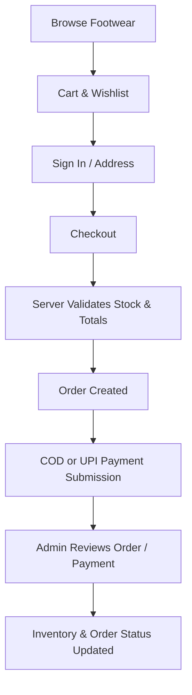

<div align="center">


<p>
  <strong>A considered shopping experience. A practical store-management system.</strong>
</p>

<p>
  <a href="https://github.com/tech-ankit-kumar/Aurum"></a>
  
  
  
</p>

<p>
  <a href="#-experience">Experience</a> ·
  <a href="#-technology">Technology</a> ·
  <a href="#-getting-started">Get Started</a> ·
  <a href="#-project-structure">Structure</a> ·
  <a href="#-security">Security</a>
</p>

</div>

---

## ✦ The Project

**AURUM** is a full-stack footwear e-commerce application designed to bring a polished storefront and essential store operations together in one project.

Customers can explore a curated catalogue, use cart and wishlist interactions, create an account, save delivery addresses, place orders, and review their order history. Store administrators get a dedicated dashboard for managing orders, checking manual UPI payment submissions, updating stock, and handling cancellation or return requests.

The project combines a custom HTML/CSS/JavaScript frontend with a Node.js + Express API and a SQLite database.

> **Project focus:** Responsive UI · REST APIs · Authentication · Database-backed workflows · E-commerce operations

## 👟 A Look at the Catalogue

<div align="center">
  <table>
    <tr>
      <td align="center" width="33%">
        <br>
        <strong>Everyday Icons</strong><br>
        <sub>Classic streetwear styles</sub>
      </td>
      <td align="center" width="33%">
        <br>
        <strong>Modern Classics</strong><br>
        <sub>Timeless silhouettes</sub>
      </td>
      <td align="center" width="33%">
        <br>
        <strong>Performance</strong><br>
        <sub>Running-inspired footwear</sub>
      </td>
    </tr>
  </table>
  <sub>Catalogue imagery included in this repository. These are product images, not application screenshots.</sub>
</div>

## ✨ Experience & Features

<table>
  <tr>
    <td width="50%" valign="top">

### 🛍️ Customer Storefront
- Responsive storefront layout
- Footwear catalogue and product browsing
- Search and product discovery
- Shopping cart and wishlist interactions
- Customer registration and login
- Saved delivery addresses
- Checkout with server-calculated totals
- Order history and order details
- Cancellation and return requests

</td>
    <td width="50%" valign="top">

### 🧰 Admin Workspace
- Dedicated admin interface
- Administrator authentication
- Store and order overview
- Order listing and status updates
- Manual UPI payment review
- Inventory and stock management
- Cancellation and return request handling
- Order notes and refund-status tracking where supported

</td>
  </tr>
  <tr>
    <td width="50%" valign="top">

### 💳 Payment Workflow
- Configurable merchant UPI details
- UPI URI and QR-code generation
- UTR / transaction reference submission
- Admin review of payment submissions
- Cash on Delivery workflow support

</td>
    <td width="50%" valign="top">

### ⚙️ Backend Foundations
- Express API endpoints
- SQLite persistence
- Password hashing
- JWT authentication in HTTP-only cookies
- Request rate limiting
- Security headers
- Server-side order and stock validation

</td>
  </tr>
</table>

## 🧭 How It Works



## 🧱 Technology

<div align="center">

| Layer | Tools |
|---|---|
| **Frontend** | HTML5 · CSS3 · Vanilla JavaScript |
| **Responsive styling** | Custom CSS · Flexbox · CSS Grid |
| **Server** | Node.js 20+ · Express 5 |
| **Database** | SQLite · `better-sqlite3` |
| **Authentication** | `jsonwebtoken` · HTTP-only cookies |
| **Password hashing** | `bcryptjs` |
| **Security** | Helmet · `express-rate-limit` |
| **Cookie parsing** | `cookie-parser` |
| **Configuration** | `dotenv` |
| **UPI QR codes** | `qrcode` |
| **Typography** | Google Fonts — Fraunces and Sora |
| **Development workflow** | npm · Node.js watch mode · Git · GitHub |

</div>

## 🚀 Getting Started

### Prerequisites

- [Node.js 20 or newer](https://nodejs.org/)
- npm
- A modern browser

Check the installed versions:

```bash
node --version
npm --version
```

### 1. Clone the repository

```bash
git clone https://github.com/tech-ankit-kumar/Aurum.git
cd Aurum
```

> If the repository has a different name on GitHub, use its exact clone URL and directory name.

### 2. Install dependencies

```bash
npm install
```

### 3. Configure environment variables

Create a local `.env` file from the example:

**Windows PowerShell**
```powershell
Copy-Item .env.example .env
notepad .env
```

**macOS / Linux**
```bash
cp .env.example .env
```

Set your own values in `.env`:

```dotenv
PORT=3000
NODE_ENV=development
JWT_SECRET=replace-with-a-long-random-secret
UPI_ID=your-upi-id@bank
UPI_NAME=Your Store Name
ADMIN_EMAIL=admin@example.com
ADMIN_PASSWORD=replace-with-a-strong-password
```

These are example values only. Use a strong, unique admin password and a long, unpredictable JWT secret. Configure your own merchant UPI details.

### 4. Run AURUM

Start the server:

```bash
npm start
```

Start in watch mode during development:

```bash
npm run dev
```

### 5. Open the app

| Page | URL |
|---|---|
| Storefront | [http://localhost:3000](http://localhost:3000) |
| Admin dashboard | [http://localhost:3000/admin/](http://localhost:3000/admin/) |

Keep the terminal running while using the app. Press `Ctrl + C` to stop the server.

## 🗂️ Project Structure

```text
Aurum/
├── admin/
│   └── index.html             # Admin dashboard UI
├── css/
│   ├── style.css              # Main storefront styling
│   └── responsive.css         # Responsive layout rules
├── images/                    # Footwear product images
├── js/
│   ├── data.js                # Frontend product/store data
│   └── script.js              # Storefront interactions
├── server/
│   ├── data/                  # SQLite database created at runtime
│   ├── index.js               # Express server and API routes
│   └── products.json          # Backend product catalogue
├── .env.example               # Environment template
├── .gitignore
├── index.html                 # Storefront entry point
├── package.json               # Scripts and dependencies
├── package-lock.json
├── START_HERE.txt
└── README.md
```

## 🧩 npm Scripts

| Command | What it does |
|---|---|
| `npm start` | Starts the Express server |
| `npm run dev` | Runs the server with Node.js watch mode |
| `npm run seed` | Runs the seed script if `server/seed.js` exists in the checkout |

## 🔌 API Capabilities

The backend groups endpoints around the following operations:

| API area | Main capabilities |
|---|---|
| **Products** | List products and retrieve product details |
| **Customer auth** | Signup, login, logout, current-session lookup |
| **Addresses** | List, add, and remove saved delivery addresses |
| **Orders** | Create orders, view order history/details, request cancellation or return |
| **Payments** | Retrieve payment information, generate UPI QR codes, submit UTR details |
| **Admin auth** | Admin login, logout, session lookup |
| **Admin operations** | Dashboard statistics, order updates, payment review, inventory changes |

Customer-specific routes require a valid customer session. Administrative operations require administrator authentication. See `server/index.js` for the exact route definitions and request formats.

## 💳 Important: UPI Payment Verification

AURUM implements a **manual UPI payment submission and review workflow**. It does not automatically confirm a payment with a bank or payment gateway.

1. A customer places an order and follows the displayed payment instructions.
2. The customer pays through their UPI application.
3. The customer submits the transaction reference / UTR.
4. An administrator verifies the payment directly against the receiving bank or UPI account.
5. The administrator updates the payment status.

**Never mark an order as paid solely because a UTR was submitted.** A transaction reference is not proof that funds were received.

## 🔐 Security

The project includes several baseline security measures:

- Password hashing with `bcryptjs`.
- JWT-based authentication using HTTP-only cookies.
- Helmet security headers.
- API rate limiting.
- Server-side validation of order totals and stock availability.
- Environment variables for secrets and local configuration.
- `.gitignore` rules for `.env`, `node_modules`, and SQLite database files.

Before any public production deployment:

- Replace every example secret and credential.
- Keep `.env`, real customer data, database files, and logs out of Git.
- Enable HTTPS and set `NODE_ENV=production`.
- Review authorization and input validation for every sensitive route.
- Back up and protect the SQLite database.
- Use a payment gateway with verified server-side webhooks if automatic payment confirmation is required.

This project should be tested and security-reviewed before handling real customer information or payments.

## 🛠️ Troubleshooting

<details>
  <summary><strong>Server does not start</strong></summary>

  - Confirm Node.js 20+ is installed.
  - Run `npm install`.
  - Check `.env` syntax and values.
  - Ensure the configured port is available.
</details>

<details>
  <summary><strong>UPI QR code is missing</strong></summary>

  - Confirm `UPI_ID` is set in `.env`.
  - Verify the UPI ID format.
  - Restart the server after changing environment variables.
</details>

<details>
  <summary><strong>Admin login fails</strong></summary>

  - Check the configured `ADMIN_EMAIL` and `ADMIN_PASSWORD`.
  - Restart the server after environment changes.
  - Do not use example credentials in a public deployment.
</details>

<details>
  <summary><strong>Product images are missing</strong></summary>

  - Confirm the `images/` directory is present.
  - Check image paths in product data.
  - Inspect the browser console and server terminal for errors.
</details>

## 🗺️ Roadmap

- [ ] Automated payment-gateway integration with verified webhooks
- [ ] Product reviews and ratings
- [ ] Advanced search, filtering, and pagination
- [ ] Email notifications for order updates
- [ ] Automated tests and continuous integration
- [ ] Production deployment and monitoring
- [ ] Image optimization and delivery improvements

## 👨‍💻 Author

**Ankit Kumar** — BCA Student · Front-End Developer · JavaScript & REST API Enthusiast

I build responsive web experiences and practical projects while continuing to develop my skills in frontend development, API integration, and full-stack application workflows.

<p>
  <a href="https://github.com/tech-ankit-kumar"></a>
  <a href="https://www.linkedin.com/in/tech-ankitkumar"></a>
</p>

---

<div align="center">

**AURUM · Move Your Way.**

<sub>Built with HTML, CSS, JavaScript, Node.js, Express, and SQLite.</sub>

</div>
